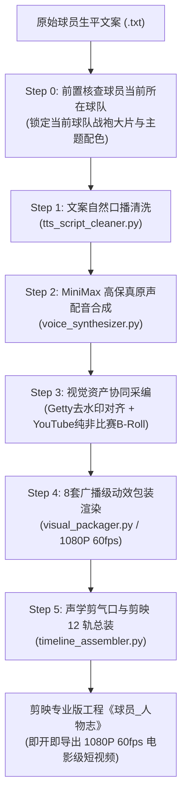

# 🏀 NBA Auto Player (`nba-auto-player`)

<div align="center">

[](https://opensource.org/licenses/MIT)
[](https://www.python.org/)
[](https://ffmpeg.org/)
[](https://www.capcut.cn/)
[](https://apple.com/)

**NBA 球员纪录片与生平人物志全自动影视级制片工坊**  
*NBA Player Documentary & Biography Autopilot Production Studio*

[核心特性](#-核心特性) • [制片流水线](#-制片流水线) • [严格制片准则](#-严格制片准则) • [快速开始](#-快速开始) • [实战验证案例](#-实战验证案例)

</div>

---

## 📖 简介

`nba-auto-player` 是专门针对 NBA 球星传记与体育影视级短视频打造的**全链路端到端自动化制片流水线**。

通过多智能体编排（Multi-Agent Orchestration），只需输入一段包含引言、关键词、基本信息与生涯履历的原始文案，系统即可全自动串联 **口播清洗、MiniMax 高保真声音合成、Getty 2048px 超清去水印图库对齐、YouTube 100% 纯非比赛纪实采编、8 大 1080P 60fps 广播级动效包装渲染**，并在声学微秒级剪气口后直接生成包含 **人声、避让 BGM、转场/快门音效、精准同步字幕与跑马灯** 的 **12 轨剪映专业版 (JianYing Pro) 工程**。

---

## ✨ 核心特性

- **🗣️ 自然口播清洗**：剔除标题、标号、日期、英文音标与生硬战报，同时严格保留 100% 原版用词、热梗、俚语及英文绰号（如 `G6汤`、`Rocco`、`哟！`）。
- **🎙️ MiniMax 高保真定制原声合成**：基于 `speech-02-hd` HD 模型与专属锁定音色合成，极具质感与情绪感染力，且避免任何二次声音克隆槽位扣费。
- **🖼️ Getty 图库数学羽化去水印重构**：按宽大于高（`W > H`）与 2048px 分辨率严格校验，锁定 $Y \in [0.608H, 0.723H]$ 结合高斯渐变羽化在频域无缝消除水印，同时自动切分“生涯编年史”与“海报级单人大片”。
- **🎥 严格纯非比赛纪实 B-Roll 采编**：**严厉拒绝比赛转播与进球集锦**，100% 搜集选秀大会、康复纪录片、赛后发布会（折纸飞机/搞笑访谈）、实验室盲投、更衣室香槟狂欢、中国行整活与训练馆原声。
- **🎨 8 大广播级 1080P 60fps 动效包装**：
  1. `01_开头人物入场_10秒`（自动匹配球员**当前所在球队战袍与主题色** + 流光人物镂空剪影 + 脑后出字）
  2. `02_核心词云过渡_4秒`（NBA 官方透明免抠大头照 + 三大阵营词云向心收敛）
  3. `03_四大小章节海报卡_8秒`（纯净无注释主标题大字，下三分之一排版不挡脸）
  4. `04/06_大章节过渡一与二_8秒`（无上方小黄字，居中大标题砸屏 + 8 秒电影感推镜）
  5. `05_详细基本信息杂志排版_12秒`（无顶部浅色水印、仅展示 6 项核心档案、当前所在球队主题色 HUD + 右侧当前球队正面定妆帅照）
  6. `07_职业生涯时期荣誉逐级弹出_18秒`（每隔 1.5 秒荣誉阶梯依次点亮）
  7. `08_职业生涯全套连续跑马灯_32秒`（16 个生涯节点横版大图 + 1px 轮廓阴影 + 相机快门音效）
- **✂️ 声学微秒级剪气口**：Whisper 字词级时间戳 + RMS 能量扫描，将逗号间隔严控在 `0.05s-0.08s`，句末严控在 `0.15s-0.20s`，剔除一切无声长空白。
- **🎬 12 轨剪映专业版全自动构建**：符合 `draft_info.json` 与 `root_meta_info.json` 架构，打开剪映首页直接呈现，支持即开即播、二次精调与 4K 60fps 极速导出。

---

## 🚦 制片流水线



---

## 🛡️ 严格制片准则

| 模块 | 准则要求 | 违规判定标准 |
| :--- | :--- | :--- |
| **当前球队核查** | 前置查明球员当前所在球队，开头入场与基本信息必须采用**当前球队照片与配色** | 使用旧东家照片或旧东家配色做开头与档案卡即判定为违规 |
| **动效纯净度** | 关键词卡不要底部小字注释；8s 大章节过渡不要上方小黄字；基本信息不要顶部水印/选秀/球衣项 | 出现多余小字注释、浅色水印、抠图多余手臂或白边即判定为违规 |
| **文案处理** | 100% 保留作者原汁原味词汇，保留英文缩写与语气助词 | 擅自将 G6 改为第六场、擅自删减叹词哟！即判定为违规 |
| **视频采集** | 100% 采集非比赛场外纪实画面 | 任何全场比赛进球集锦、比赛转播即时回放均被拦截剔除 |
| **图片去水印** | 仅选用纯横版大图（$W > H$），数学限定羽化重构 | 竖版海报或产生模糊涂抹痕迹均判定为不合格 |
| **配音气口收紧** | 针对 TTS 合成语音**只缩短纯静音气口**（保留 40~60ms 余音垫），**严禁随意切断文字** | 切碎句内连贯发音、吞字头/字尾或产生拼接爆音即判定为违规 |

---

## 🚀 快速开始

### 1. 环境依赖
```bash
git clone https://github.com/YoungG97/nba-auto-player.git
cd nba-auto-player
pip install -r requirements.txt
```
*注：系统需预先安装 `ffmpeg` 与 `yt-dlp`。*

### 2. 交互式逐步制片（推荐）
```bash
python3 scripts/auto_player_pipeline.py \
    --script /path/to/player_script.txt \
    --player 克莱·汤普森 \
    --out ~/Downloads
```
*每个阶段完成后将展示资产统计，待人工输入 `y` 确认后自动推进下一阶段。*

### 3. 一键全自动无人值守出片
```bash
python3 scripts/auto_player_pipeline.py \
    --script /path/to/player_script.txt \
    --player 贾·莫兰特 \
    --out ~/Downloads \
    --auto
```

---

## 📚 实战验证案例

- **贾·莫兰特 (`Ja Morant`)**：
  - 产物目录：`~/Downloads/莫兰特/`
  - 资产：42 张 Getty 去水印横版原图 + 18 段 YouTube 非比赛纪实原片 + 8 套 60fps 动效包。
  - 剪映工程：`《贾·莫兰特_人物志》`（已成功构建 12 轨工程并导出）。
- **克莱·汤普森 (`Klay Thompson`)**：
  - 产物目录：`~/Downloads/克莱·汤普森/`
  - 资产：42 张超清横版图 + 18 段纯非比赛高清视频（含折纸飞机/脚手架/保罗乔治播客/爱犬开船）。
  - 剪映工程：`《克莱·汤普森_人物志》`。

---

## 📄 开源许可证

本项目基于 [MIT License](LICENSE) 开源协议。
