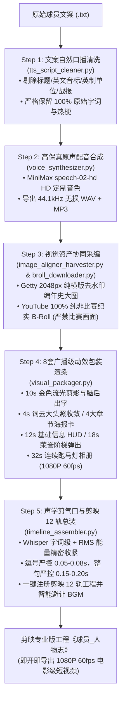

# NBA Auto Player (`nba-auto-player`)

🏀 针对 NBA 球星深度纪录片与生平人物志打造的**全链路端到端全自动影视级制片工坊**。

本套件作为多智能体（Multi-Agent）主控中枢，将 **文案清洗、高保真声音克隆、Getty 图库去水印对齐、YouTube 纯非比赛纪实采编、广播级 60fps 动效渲染** 与 **剪映专业版 12 轨时间线自动化构建** 深度贯通，只需输入一份原始球员传记文案，即可全自动输出工业级成片工程。

---

## 🚦 五大阶段制片流水线



---

## 🛡️ 核心制片红线与技术标准

### 1. 文案保留红线 (100% Vocabulary Preservation)
- 仅剔除“引言部分：”、“关键词部分：”、“基本信息部分：”等结构性标签、英制换算与编年史长战报。
- **严禁擅自篡改作者原文词句**（如英文绰号 `G6`、爱犬名字 `Rocco`、语气词 `哟！`、俚语词汇 `细数一下`、`重披`、`血帽` 等必须 100% 原汁原味保留）。
- 仅做规范口语转换（如 `2次` -> `两次`，`1.96 m` -> `1米96`，`100 KG` -> `100公斤`）。

### 2. 视频采编最高禁令 (Zero Broadcast Game Footage)
- **严禁下载比赛转播画面、比赛集锦或进球合集（Zero Game Highlights）**！
- 必须 100% 聚焦于场外纪实：
  1. 选秀大会叫号与登台采访
  2. 伤病康复训练馆纪实（如 941 天复健纪录片）
  3. 赛后发布会原声（折纸飞机、名发言、搞笑名场面）
  4. 运动科学实验室（ESPN Sport Science 盲投测试）
  5. 更衣室夺冠香槟狂欢
  6. 中国行整活、私人游艇出海、爱犬互动
  7. 休赛期私人训练馆投篮原声

### 3. Getty 图库数学羽化去水印重构
- 严格限定横版图片宽高比（`Width > Height`）且宽度 $\ge 2048\text{px}$。
- 水印定向区域锁定：$Y \in [0.608H, 0.723H]$，$X \in [0.580W, W]$。
- 结合多尺度 Telea 补全、高斯渐变羽化过渡与反差锐化补偿，彻底消除边界硬痕迹与模糊块。

### 4. 声学微秒级剪气口标准
- **逗号/短从句**：严格收紧至 **0.05s ～ 0.08s**。
- **完整句子/换气句**：严格收紧至 **0.15s ～ 0.20s**。
- **无效长气口**：超过 0.15s 的静音空白与吸气杂音自动剔除，保持极其紧凑有力的解说节奏。

---

## 🛠️ CLI 快速使用

### 1. 逐步确认人机交互制片 (推荐)
```bash
python3 scripts/auto_player_pipeline.py \
    --script /path/to/klay_raw_script.txt \
    --player 克莱·汤普森 \
    --out ~/Downloads
```
*流程将在每个核心阶段完成后暂停并打印详细摘要，待人工确认输入 `y` 后自动推进到下一步。*

### 2. 一键无人值守全自动出片
```bash
python3 scripts/auto_player_pipeline.py \
    --script /path/to/morant_raw_script.txt \
    --player 贾·莫兰特 \
    --out ~/Downloads \
    --auto
```

---

## 📁 产出物目录规范

```text
~/Downloads/<球员姓名>/
├── <球员姓名>_TTS口播文案.txt
├── <球员姓名>_配音原声.mp3
├── <球员姓名>_配音原声.wav
├── <球员姓名>_配音精修紧凑版.wav
├── <球员姓名>_高清图片素材/
│   ├── 01_生涯经历与文案对应图/ (16~20 张编年史横版原图)
│   ├── 02_海报级纯享单人精选大片/ (25~30 张单人封面壁纸)
│   └── <球员姓名>_高清素材索引清单.md
├── <球员姓名>_视频素材/
│   ├── 01_引言_.../ (3 段 1080P MP4)
│   ├── 02_关键词一_.../ (3 段 1080P MP4)
│   ├── 03_关键词二_.../ (3 段 1080P MP4)
│   ├── 04_关键词三_.../ (3 段 1080P MP4)
│   ├── 05_关键词四_.../ (3 段 1080P MP4)
│   └── 06_基本信息与结尾_.../ (3 段 1080P MP4)
└── <球员姓名>_动效包装/
    ├── 01_开头人物入场_10秒.mp4
    ├── 02_核心词云过渡_4秒.mp4
    ├── 03_四大小章节海报卡_8秒.mp4
    ├── 04_大章节过渡一_基本信息_2.5秒.mp4
    ├── 05_详细基本信息杂志排版_12秒.mp4
    ├── 06_大章节过渡二_职业生涯经历及成就_2.5秒.mp4
    ├── 07_职业生涯时期荣誉逐级弹出_18秒.mp4
    └── 08_职业生涯全套连续跑马灯_32秒.mp4
```
*剪映专业版工程自动注入：`~/Movies/JianyingPro/User Data/Projects/young/JianyingPro Drafts/<球员姓名>_人物志/`*
